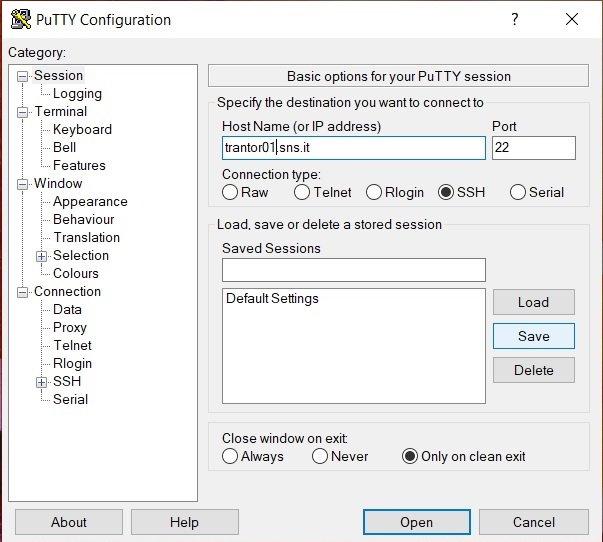
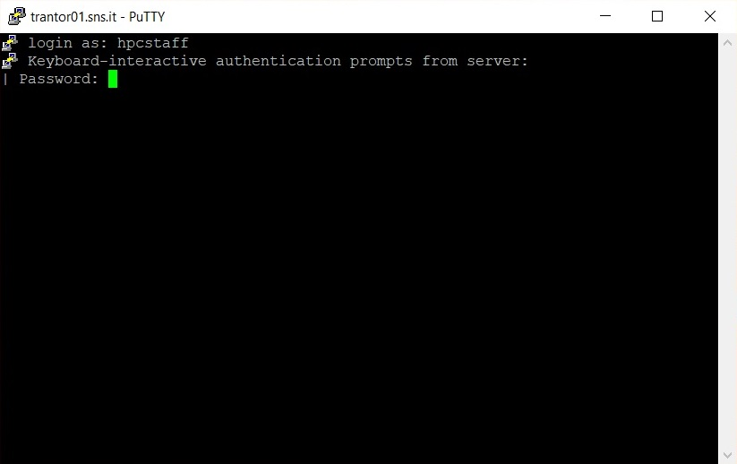
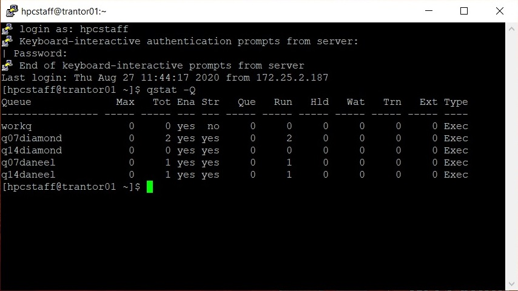
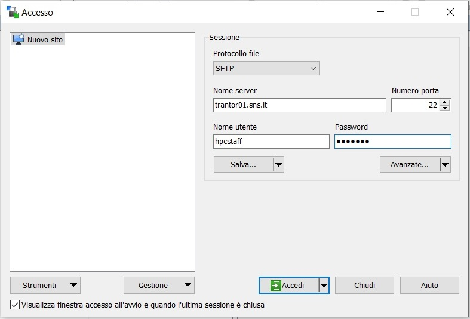
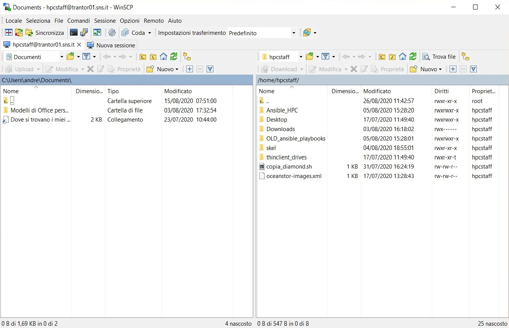
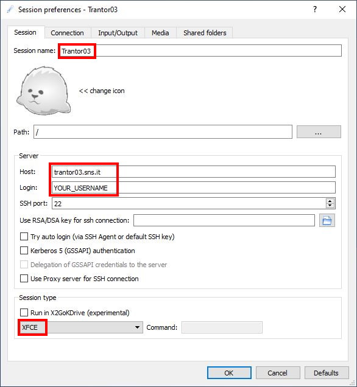
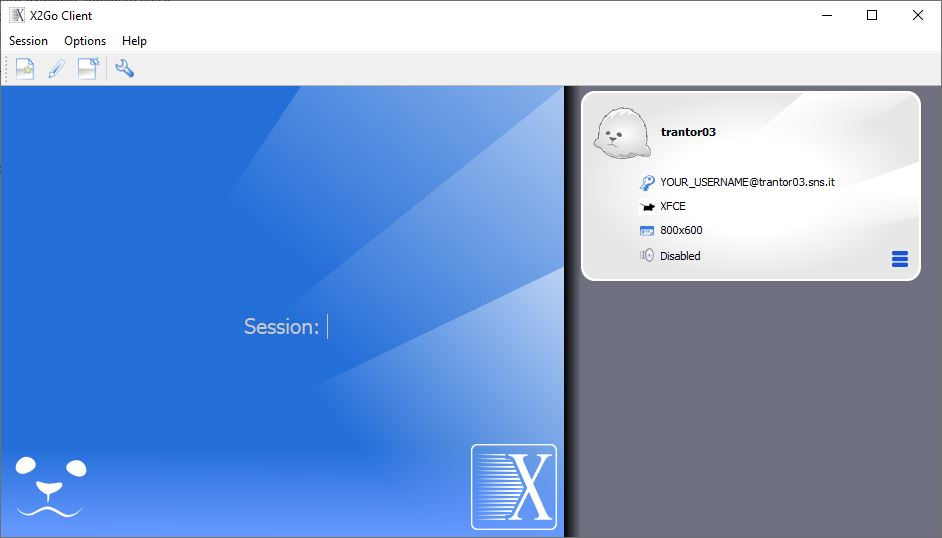
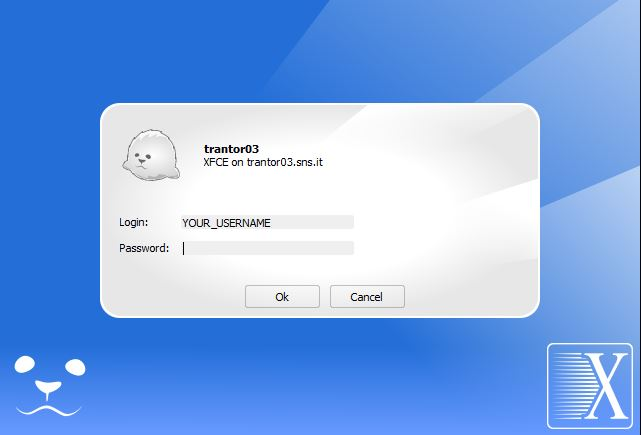
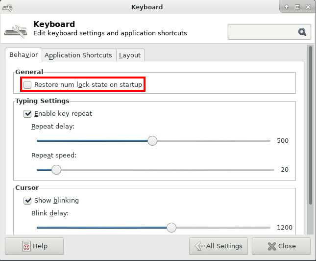

To get access to (most) of the cluster resources, you must first login into one of the available *head nodes*:

| Head node | Access | Features |
|:----------|:-------|:---------|
| **trantor01.sns.it** | Open access | — |
| **trantor02.sns.it** | Open access | — |
| **trantor03.sns.it** | Open access | Equipped with a desktop environment (X2Go) |
| **hypnos.sns.it** | *interstellar* group only | Equipped with a desktop environment (X2Go) |
| **cinna.sns.it** | *compnanobio* group only | Equipped with a desktop environment (X2Go) |
| **gaia01.sns.it** | *bioinfo* group only | Acts both as head-node and compute node |

Login and commands execution on the head-nodes are usually managed by the **SSH** protocol. However, some of the head-nodes (such as *trantor03.sns.it*) are also equipped with a desktop environment (Xfce) and the **X2Go** remote desktop solution.

Instructions on how to access the cluster using SSH and X2Go are discussed in the following.

## First login to the cluster
At your first login, you will be prompted to change the password:

```bash
ssh username@trantor01.sns.it
# Enter the one-time password
Password expired. Change your password now.
# Enter the one-time password once again
# Enter a new password
# Confirm the new password
```

The password must be at least 12 characters long and must contain an uppercase letter, a lowercase letter, a digit and a special character. Furthermore, it is not allowed to use the same character three or more times in a row. Finally, when the password expires, old passwords can not be reused.

## Getting started with SSH
**Secure Shell** (SSH) is a cryptographic (encrypted) network protocol to allow remote login and other network services to operate securely over an unsecured network. The most visible application of the protocol is for access to shell accounts on Unix-like operating systems.

SSH can be used for both command line and GUI applications.

### Using Windows

**Windows 10** has an official SSH client now. It can be enabled in the Settings panel clicking on Settings → Optional features → Add a feature → OpenSSH Client (if already enabled it will appear in the "Optional features" list). It can be used on any terminal application like the standard `cmd` console prompt or Windows PowerShell. You can also try **Windows Terminal** from Microsoft App store.

On older versions of Windows, things are a little more involved. Older Windows does not come with a built-in SSH client, so you have to install one first. We recommend the popular software [PuTTY](http://www.chiark.greenend.org.uk/~sgtatham/putty/download.html), which is free and well made.

1. Download PuTTY;
2. Run `putty.exe`;
3. Login to server `trantor01.sns.it` as shown below:



Type in user-name and password:



You now have your Unix/Linux prompt. On our cluster, the command `qstat -Q` will show you a quick summary of the queues status, as you can see below:



Also, if you need to securely transfer a file between a local and a remote computer, [WinSCP](http://winscp.net/eng/download.php) offers basic file manager and file synchronization functionality.

1. Download WinSCP;
2. Execute `WinSCP.exe`;
3. Login to `trantor01.sns.it` with username and password:





### Using Linux

To access the cluster from Linux:

1. Open Gnome Terminal or any other terminal emulator;
2. Install SSH if you don't have it already; refer to the documentation of your Linux distro to know how to do it;
3. Type `ssh yourusername@trantor01.sns.it`;
4. Type your password;
5. Do your stuff.

To close the session, type `exit` or press CTRL + D. For secure file transfer, you can use the command line utilities `scp` or `sftp`, for example:

```bash
$ scp -r yourusername@trantor01.sns.it:mydata/myresults ./localdir/
```

`scp` starts the relative path from the user home directory; the `-r` switch is used to recursively copy the directory and its content.

As an alternative, you can also use built-in remote capabilities in a file-browser such as Nautilus in Gnome:

1. Open file browser (Nautilus);
2. Switch to "Go To" view: use key combination CTRL + L;
3. In "Go-to" input box type `sftp://trantor01.sns.it`;
4. Type your username and password, then select "connect".

### Using MacOS X

This is how to login the cluster from a Mac, it works more or less like in Linux (see above):

1. Open Terminal;
2. Type `ssh yourusername@trantor01.sns.it`;
3. Type your password;
4. Do your stuff.

To close the session, type `exit` or press CTRL + D. Refer to the Linux paragraph for instructions on how to use SCP.

## Getting started with X2Go

In addition to SSH access, some of the head-nodes (such as *trantor03.sns.it*) also provide a **remote desktop environment**. In particular, they are equipped with the [Xfce](https://www.xfce.org) desktop environment and an [X2Go](https://wiki.x2go.org) server.

To use remote desktop, you first need to install the **X2Go** client. You can refer to the [official documentation](https://wiki.x2go.org/doku.php/doc:installation:x2goclient) for instructions on how to install the client on various platforms.

Once the client is up and running, create a new session by selecting the menu item *"Session → New session.."*. A new dialog will appear, asking for connection details. Fill the form as follows:

- **Session name**: whatever you like (e.g. 'Trantor03')
- **Host**: the fully-qualified domain name of the head-node (e.g. trantor03.sns.it)
- **Login**: your username
- **Session type**: XFCE



Then press "OK" to save the session preferences. A small gray box representing the session will appear at the right side of the window:



Click on it. A login dialog will appear. Insert your credentials and press "Ok":



The remote desktop window should start in a few seconds.



**Hint:** Test if the keyboard numpad is working correctly within the remote desktop. If not, open the Xfce's keyboard settings and disable the "Restore num lock state on startup" checkbox. Finally, close and re-open the X2Go session.




