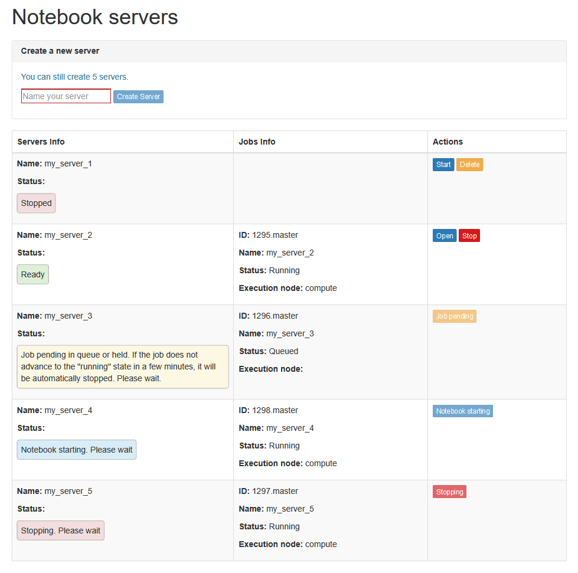
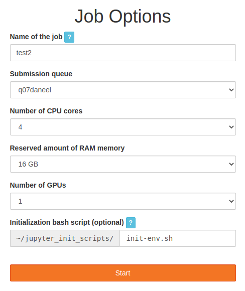
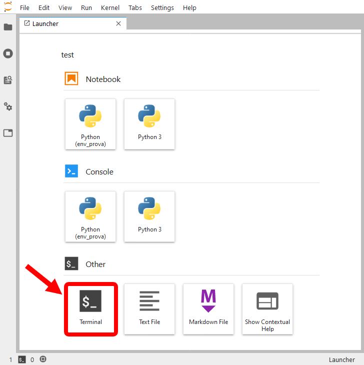
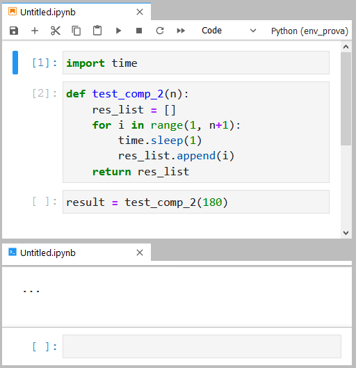
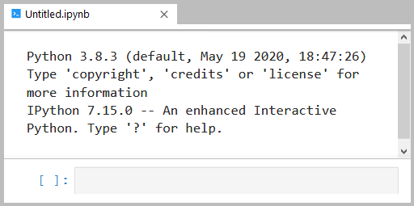
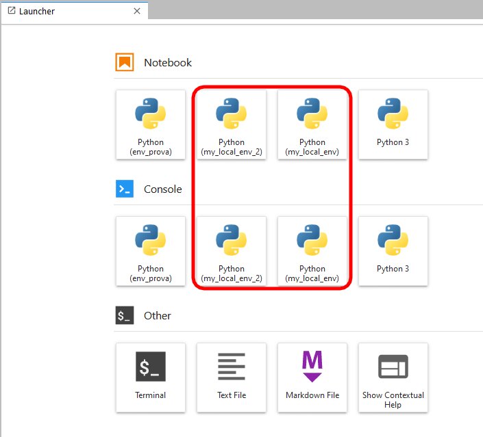
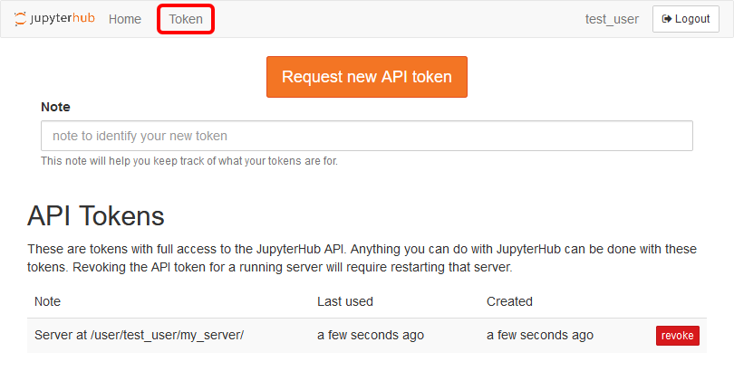

## Introduction
Jupyter notebooks are implemented as Web applications. The server implements the
"notebook" abstraction and dispatches the code contained in the notebook to an interpreter,
for its actual execution.

In Jupyter terminology, such interpreters are called "kernels" (e.g. the
kernel used to execute Python code is part of the [IPython project](https://ipython.org/)).
While it is common to run a single notebook server locally on the user's machine, the system
described in this document allows the execution of several servers per user on compute
nodes, thus allowing the execution of multiple calculations on high-performance machines in
an interactive (or semi-interactive) fashion.

This system is a customized version of the [JupyterHub](https://jupyter.org/hub) application.
In the rest of the document we will refer to it as "JupyterHub@Trantor".

## Software requirements
To use JupyterHub@Trantor you just need a modern Web browser. Installing a Python / R
distribution on your local machine is not required, since notebooks will be executed on the
cluster.

## Account request
To access JupyterHub@Trantor, you need a personal account on the Trantor cluster. To this
end, please fill the [form](https://hpccenter.sns.it/page/forms/index.html).
Then your SNS contact (professor or researcher) need to sign the form and send it via email
to hpccommittee@sns.it.



The Trantor cluster can be accessed only from the internal SNS network. If you are
working off-site, you need to establish a VPN connection to the SNS network.
[Here](https://ict.sns.it/en/service/access/vpn) you find instructions
on how to download and configure the VPN client.



## Logging into the system
To access JupyterHub@Trantor, visit the [web page](https://jupyter.sns.it) from the internal SNS network
or via a VPN connection to the SNS network.
From that page, you can log into the system by providing the credentials of your Trantor account.
Please note that you will be prompted to re-enter your credentials every day.

## Notebook servers management
The home page (see Figure 1) shows several information about the notebook servers and
provides the tools to manage them.

To create a new server, insert a name in the form at the top of the home page and press the
"Create Server" button (see Figure 1). Server names can contain only letters, digits and the
underscore character. Furthermore, they must start with a letter. Each user can run up to 10
notebook servers at the same time.



Once created, you will be redirected to the "Job" submission form, from which you can
specify the resources to be reserved for the Job[^1] (see Figure 2).

[^1]: You can find a brief introduction to job scheduling systems at the following Web page: [Submitting, Inspecting and Cancelling PBS Jobs](/docs/pbs)



Here you have to enter:

- A name for the job. By default the Job is named after the associated server, but you
  can rename it if you wish.
- The submission queue.
- The number of CPU cores to be reserved.
- The amount of RAM memory to be reserved.
- The number of GPUs to be reserved.
- Optionally, you can also provide the name of a bash script to be executed before
  starting the notebook server, e.g. with the purpose of initializing the environment.
  The script must be stored in a folder named "jupyter_init_scripts" within your
  home directory.

You can then confirm the submission by pressing the "Start" button.



The requested computational resources are allocated on a single node. Currently,
JupyterHub@Trantor does not allow to reserve multiple compute nodes for a single Job.



If the notebook server begins its execution in a short time, the browser will be automatically
redirected towards the JupyterLab application (see section 6). Otherwise it will return to the
home page, from which you can monitor the starting process.

As shown in Figure 1, the main area of the home page consists in a table listing the
notebook servers, a summary of their status and the buttons to manage them.

It is important to note that, apart from active servers, the table may also contain servers that
already finished their execution. Such "stopped servers" are just placeholders: they don't
consume computational resources (there are no corresponding jobs), and their only purpose
is to provide a shortcut to start a new server instance with the same name and
computational resources.

The first column of the table shows the name and the status of each server. Possible server
states are:

- **Stopped**: The server is not currently active and it is not associated with any Job.
  This is just a "shortcut" to start a new server instance with the same name and
  computational resources. You can delete this "shortcut" by means of the "Delete"
  button on the third column.
- **Job pending**: The Job is pending in a queue or it was put in the "Held" state[^2]. If the
  job does not advance to the "Running" state in a few minutes, it will be automatically
  stopped.
- **Notebook starting**: The job is being executed but the notebook server is still
  starting up.
- **Notebook ready**: The notebook server is up and running. Press the "Open" button
  on the third column to open the notebook. Press the "Stop" button to stop the server
  and the related Job.
- **Stopping**: The notebook server and the related Job are being stopped.
- **Checking**: JupyterHub is checking the state of the notebook server.
- **Removing**: The job is terminated and the related entry is being removed from
  JupyterHub.
- **Unexpected**: The server is in an inconsistent state. Please report the problem to
  hpcstaff@sns.it.

The second column of the table summarizes the main information about the Job: Job ID,
name, status (as reported by the "qstat" utility[^1]) and the compute node on which the Job is
running. Please provide these information when you contact the technical support.

[^2]: Please refer to the PBS Professional User's Guide for details.

## JupyterLab usage
JupyterLab is the new web-based user interface for working with Jupyter notebooks. The
complete JupyterLab user's guide can be found at the following Web page:
[https://jupyterlab.readthedocs.io/](https://jupyterlab.readthedocs.io/).

Please note that some JupyterLab features are not available in JupyterHub@Trantor, e.g.
the ability to add extensions.

### Files management and scratch areas
You can use the built-in file manager to browse the content of your home folder, open files in
JupyterLab, and even download / upload files to / from your personal computer.



The uploading functionality provided by JupyterLab is suitable only for small files (up to a
few megabytes). In the case of large data files, please use tools like rsync, scp or sftp.



It is important to note that, while the file browser is restricted to the home folder, you can
access other file system locations by using the built-in terminal (see Figure 3).



Home directories are mounted on Trantor as NFS file systems. While this solution has the
advantage of giving access to the same home folder from every node of the cluster, it is a
major bottleneck for I/O operations. For this reason, Jobs must make use of local scratch
areas when performing any significant I/O. In particular, every user has a scratch space on
every computing node, under `/scratch/$USER`. Whenever possible, this storage area is
allocated on the local hard drives, thus providing higher bandwidth and lower latency than
NFS file systems.

Here are some important notes on the use of scratch areas:

- You must perform any significant I/O operation on the scratch area. Using your
  home directory as a scratch space is forbidden.
- By the end of the computation, remember to copy any relevant file from the scratch
  folder back to your home. In fact, local scratch areas are not backed up and can be
  erased by the staff for maintenance purposes. Also remember to clean up your
  scratch folder by deleting the files you don't need anymore.

You can find further details on scratch areas at the following web page:
[Submitting, Inspecting and Cancelling PBS Jobs - Scratch Areas](/docs/pbs#Scratch_Areas)



When running multiple notebook servers, they can potentially operate on the same files.
This is extremely dangerous, since it can lead to data loss or corruption!
Our suggestion is to organize your work in such a way that each server operates on a
different folder, so as to avoid opening the same files from multiple servers.



### Long-running computations in Jupyter Notebooks
One of the advantages of using JupyterHub@Trantor is the ability to embed long-running
computations in Jupyter notebooks and to execute them on the cluster. However, due to
technical limitations of JupyterLab, you have to take some specific precautions to avoid
losing results!

As an example, consider this simple Python function that prints a number every minute for
the amount of minutes given as parameter:

```python
import time

def loop(n):
    for i in range(n):
        print(i)
        time.sleep(60)
```

Let's call this function passing 180 as parameter, so that it will keep running for three hours:

```python
loop(180)
```

Now assume that, after a few minutes, we save the notebook and close the browser. When
after three hours we open the notebook again, we could be shocked by finding that the only
results on the notebook are those present at the time of saving (i.e. before closing the
browser)!

Furthermore, if we look at the bottom-left corner of the window, the status of the kernel is
reported as "Unknown" (see below) or even "No Kernel!", meaning that the application is not
aware of the current status of the kernel.


The reason is that, when we close the tab of the browser, also the connection between the
kernel and the frontend drops. As a consequence, all the subsequent output generated by
the kernel (intended to be displayed on the notebook) will be lost. Unfortunately this is a
known limitation of the current implementation of Jupyter:
[https://github.com/jupyter/notebook/issues/1647](https://github.com/jupyter/notebook/issues/1647).

For this reason, special precautions have to be taken when writing code that may run for a
not negligible amount of time.

First of all, it is important to note that the internal state of the kernel is not affected by the
client disconnection and that the connection between the client and the kernel can be
restored. Therefore, by saving the results in a variable we can retrieve them at a later time,
even if the client disconnects during the computation. Below you can find a different
implementation of our example function, which exploits this observation:

```python
import time

def loop(n):
    results = []
    for i in range(n):
        results.append(i)
        print(i)
        time.sleep(60)
    return results
```

Now, if we close the browser tab (remember to save the notebook!) and we come back when
the computation is over, we can retrieve the results from the variable (even if the client
complains about not knowing the current state of the kernel):

```python
results = loop(100)
print(results) 
```



If you shut down, restart or change the kernel, the entire kernel state is lost, including any
result that has not been saved to file!





Most of the time we can't know in advance the exact duration of a computation. So, how
can we check if the computation is still running? A simple trick is to open an IPython
console associated with the notebook (right click on an empty space on the notebook and
select the item "New console for notebook" from the contextual menu):



If the content of the console is an ellipsis (a series of three dots), it means that the kernel
is currently busy. When the kernel will end the execution of all the submitted commands,
the ellipsis will be replaced by a print of the Python and IPython versions:



If you try to execute a cell when the kernel is busy, its code will be appended to a queue of
commands, waiting to be executed.



An even better solution is to save both final and intermediate results to file. By doing so,
most of your work is preserved even in the case of software crashes (and some types of
hardware failures). Longer is the computation, more important is to save intermediate
and final results to file.

Finally, a useful tool for dealing with third-party code that prints data on screen is the
"capture" magic command provided by IPython. By inserting the directive

```
%%capture variable
```

at the beginning of a cell, all the output generated by the cell and directed to the standard
output, to the standard error or displayed by means of the IPython's display module, is
instead captured and stored into the specified variable. It is then possible to display the
captured content by calling the `show()` method on the variable:

```python
variable.show()
```

Further details on the "capture" magic command can be found on the IPython official
documentation: [https://ipython.readthedocs.io/en/stable/interactive/magics.html](https://ipython.readthedocs.io/en/stable/interactive/magics.html)

## Running notebooks in a custom conda environment
Conda is both an environment management system (similarly to "virtualenv") and a package
management system (similarly to "pip"). While it focuses on Python, it can also be used to
install libraries for other programming languages as well as software binaries.

Is it possible to "expose" your custom conda environments so that they can be recognized by
JupyterLab, thus allowing to use them as execution environments for your notebooks.

You can find an introduction to the use of conda on the Trantor cluster at the following link:
[A brief introduction to using Conda on the cluster](https://hpccenter.sns.it/page/wiki/pages/A_brief_introduction_to_using_Conda_on_the_cluster.pdf)

Carefully read it before continuing!

### Creating a custom Python-based virtual environment
In addition to what explained in the conda introductory guide (see the link above), in order to
use a Python-based conda environment in JupyterLab you also need to install the ipykernel
(IPython kernel) package. If you wish to make use of interactive widgets in your notebooks,
you also need the ipywidgets and jupyterlab_widgets (important: use version 1.*)
packages:

```bash
conda create -n my_local_env python=x.y ipykernel ipywidgets jupyterlab_widgets=1.* further_packages ...
```

Finally, after activating the new environment, you have to expose the IPython kernel to
JupyterLab:

```bash
conda activate my_local_env
python -m ipykernel install --user --name 'my_local_env' --display-name "My Local Env"
```

When starting a new notebook server you should be able to see your local custom
environments in the JupyterLab launcher (see figure below).



### Creating a custom R-based virtual environment
As a prerequisite, be sure to set conda-forge as the primary channel for searching and
downloading packages, as explained in the conda introductory guide (see the link above).

In order to use a R-based conda environment in JupyterLab, apart from installing r-base and
r-essentials, you also need xorg-libx11, xorg-libxext xorg-libxrender and xorg-libxt:

```bash
conda create -n my_local_env r-base r-essentials xorg-libx11 xorg-libxext xorg-libxrender xorg-libxt further_packages ...
```

Exposing the R kernel to JupyterLab is a bit more complicated than the Python scenario.
First of all, find the name of the directory containing the current installation of JupyterLab. It
is located under `/cluster/shared/software/` and its name follows the pattern
`jupyter_yyyymmdd`:

```bash
ls /cluster/shared/software/
```

Then activate the new R environment:

```bash
conda activate my_local_env
```

Now you need to start the R shell, but with a modified PATH environment variable where
`/cluster/shared/software/jupyter_yyyymmdd/bin` is prepended to the PATH content:

```bash
PATH=/cluster/shared/software/jupyter_yyyymmdd/bin:$PATH R
```

Within the R shell, execute the following command:

```r
IRkernel::installspec(name="my_env_name", displayname="My Env Name")
```

Finally exit from the R shell:

```r
q()
```

The shell will ask if you want to save the workspace. Answer `n`:

```
Save workspace image? [y/n/c]: n
```

When starting a new notebook server you should be able to see your local custom
environments in the JupyterLab launcher.

### Installing Plotly
In order to to use the Plotly graphing libraries ([https://plotly.com/graphing-libraries/](https://plotly.com/graphing-libraries/)) to
produce graphs and charts in JupyterLab, install one of the following packages (or both):

- `plotly=4.9` - for Python
- `r-plotly=4.9` - for R

As regards to the Python version of Plotly, many features also require pandas as
dependency.

Please note that version matters! Different versions of these packages may lead to
incompatibility problems with the current installation of JupyterLab.

## Logs
The logs generated by each execution of the notebook server are stored in the `jupyter_logs`
folder in your home directory. Please note that the log file for a given server will be available
only after the termination of the related job.

Remember to clean up the `jupyter_logs` folder from time to time, since its content is
accounted for in your disk space quota.

## Service availability
JupyterHub@Trantor is unavailable every night from 02:00 to 02:15, due to the execution of
automatic backup procedures. Note that the stop of JupyterHub does not affect the notebook
servers running on compute nodes.

## Best practices
- Be sure to frequently save to file both the notebooks and the results, so as to
  preserve your work in the case of software crashes, loss of connection between the
  hub and the notebook server and some types of hardware failures. Longer is the
  computation, more important is to save intermediate and final results to file!
- Jupyter notebooks are designed primarily for algorithms prototyping and for
  interactive data analysis. Although one of the main benefits of running Jupyter
  notebooks on a compute node is to allow the execution of long-running computations
  directly from within the notebook, their execution time should be in the order of a few
  days, at most. For longer computations it's highly recommended to develop a
  dedicated Python program and to manually submit it as a PBS job.
- Perform any significant I/O operation on the scratch area.
- By the end of the computation, always copy any relevant file from the scratch area to
  your home directory. Then, clean up your scratch folder.
- Although JupyterLab's user interface allows files uploading, this feature should be
  used only for small files (up to a few megabytes). In the case of large data files,
  please use tools like rsync, scp or sftp.
- When running multiple notebook servers, they can potentially operate on the same
  files. It should be noted, however, that manipulating a file from more than one
  server is extremely dangerous, since it may lead to data loss or corruption!
  Our suggestion is to organize your work in such a way that each server operates on
  a different folder, so as to avoid opening the same files from multiple servers.
- Upon server termination, double check the actual termination of the corresponding
  job by means of the `qstat` command.
- Remember to clean up the `jupyter_logs` folder from time to time, since its content is
  accounted for your disk space quota.

## Known bugs
- In the Job submission form (see Figure 2), the start of a new server may fail with the
  following error message "Failed to recv data from background qsub". This is due
  to an open bug of PBS. Just return to the home page and try again.

- Whenever a notebook server is started, JupyterHub generates a random
  authentication token which is passed to the notebook server. The list of the active
  tokens can be accessed by clicking on the "Token" link of the navigation bar (see
  Figure 4).



In normal conditions, these tokens are automatically revoked at the termination of the
related notebook servers. However, in case of errors when starting or stopping the
server (e.g. due to the bug described above), the associated token may not be
automatically removed.

It is a good practice to periodically check the Tokens page and to manually revoke
any pending token. Keep in mind, however, that this procedure must be performed
when no notebook server is running!
As a matter of fact, revoking the token of a running server may lead to
malfunctions that require the re-start of the server.

- The download buttons in the main and contextual menus of JupyterLab do not work
  in Chrome.

- Sometimes the R Kernel (IRkernel) hangs when restarted. If this happens, shut down
  the kernel and then re-assign the kernel to the notebook.

If you experience a malfunction or find a new bug, please send a report to hpcstaff@sns.it.
