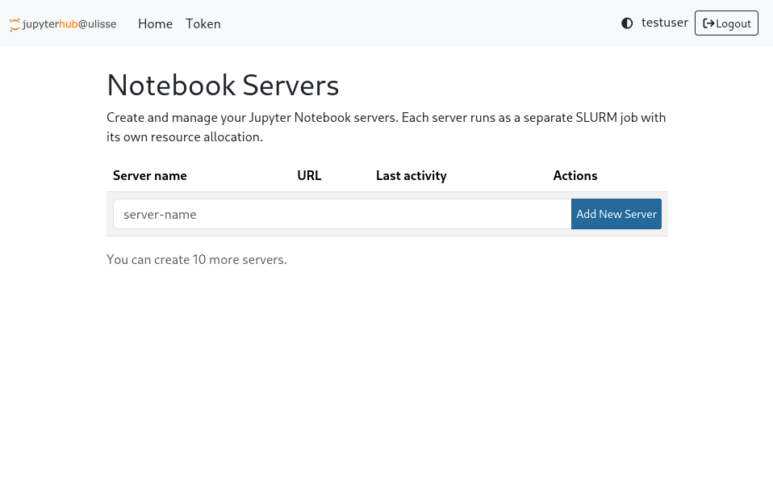
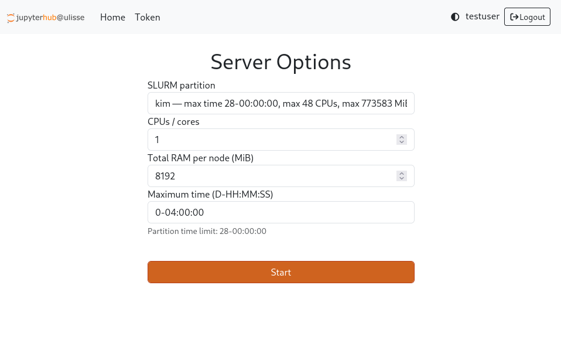
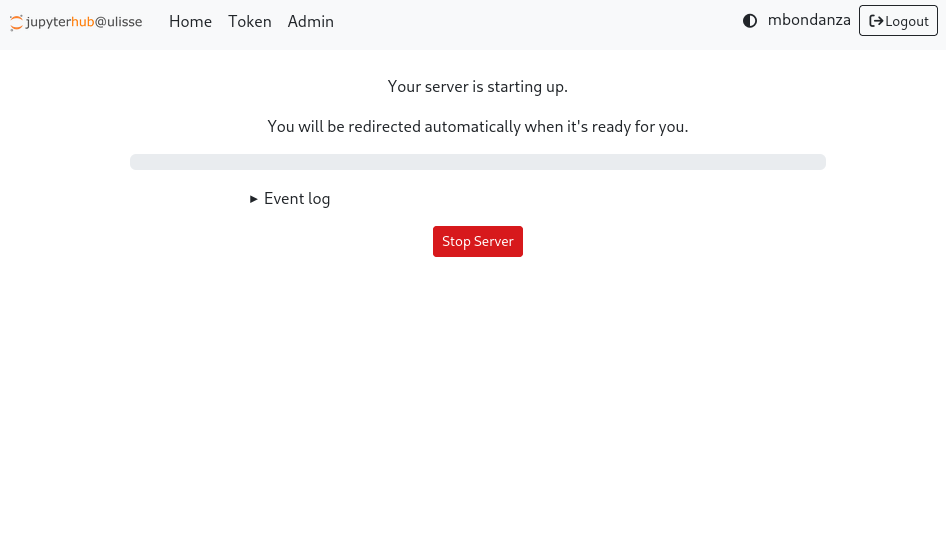

[Jupyterhub](https://jupyterhub.chpc.sns.it) is an easy and powerful interface to Ulisse's 
computational resources. It allows to run Jupyter Notebook with `Python` and `R` kernels, 
to create, edit and move files from a web interface and to have a remote terminal on the 
node, again from web ui. 

## Software Requirements
To use Jupyterhub you only need a modern browser, that you likely already have installed on
your PC.

## Accounting
JupyterHub acts just as an interface and resources are always requested and allocated through
the SLURM scheduler. Please refer to [scheduler documentation](/docs/ulisse/scheduler) for more details.

## Access and Requesting a Job


Jupyterhub website is only visible from SNS internal network. 
If you are working off-site, you need to establish a VPN connection to the SNS network.
[Here](https://ict.sns.it/en/service/access/vpn) you find instructions
on how to download and configure the VPN client.



{}

<h3>Browse <a href="https://jupyterhub.chpc.sns.it">Jupyterhub webpage</a></h3>

<h3>Enter your personal account's username and password (the same used to ssh into Ulisse)</h3>


<h3>Use "Add New Server" to create a new JupyterHub server instance</h3>



<h3>Click on "Start"</h3>


<h3>Configure the partition, and resources needed and again on "Start" to submit the job</h3>



<h3>Wait for the job to start</h3>


It can take a while, as the job have to be scheduled and the resources have to became available.
Read more about that [here](/docs/ulisse/scheduler/#power-saving).





It could happen that the starting up page remain stuck even after the compute node is available.
If you see from `squeue` that your job is running, but you are still in the loading page, just try
to reload the page in your browser.




{}

## Creating Custom Environments (Python)

The basic kernel available on JupyterHub can cover only a limited set of applications. For
more complex scientific tasks, customized environment are often needed.

You can create your own Python virtual environment and use it as a kernel in JupyterHub, without involving the administrators. Two tools are available: the standard `venv` + `pip`, and [`uv`](#using-uv), which is faster and can use the Python versions installed on the cluster.

### Using venv and pip

{}

<h3>Create the environment</h3>

Open a terminal in JupyterLab (or log in via SSH) and run:

```bash
python3 -m venv ~/envs/myenv
source ~/envs/myenv/bin/activate
pip install ipykernel
```

<h3>Register it as a kernel</h3>

```bash
python -m ipykernel install --user --name myenv --display-name "Python (myenv)"
```

<h3>Use it</h3>

Refresh JupyterLab. **Python (myenv)** now appears in the kernel picker. Install any further packages with `pip` while the environment is activated.

{}

### Saving an environment

To record the packages installed in an environment, activate it and export the list to a `requirements.txt` file:

```bash
source ~/envs/myenv/bin/activate
pip freeze > ~/envs/myenv-requirements.txt
```

Store the file in your home (or another persistent location), not inside the environment directory, so it survives if the environment is deleted.

To rebuild the environment later, or on another node:

```bash
python3 -m venv ~/envs/myenv
source ~/envs/myenv/bin/activate
pip install -r ~/envs/myenv-requirements.txt
python -m ipykernel install --user --name myenv --display-name "Python (myenv)"
```


`pip freeze` lists every installed package with its exact version, including `ipykernel`. Rebuild with the same Python version you used originally, since some pinned versions are not available for every Python release.


### Installing the environment outside your home

Large environments can be faster on the node's local disk. You can create the environment under `/scratch` and register it the same way:

```bash
mkdir -p /scratch/$USER/envs
python3 -m venv /scratch/$USER/envs/myenv
source /scratch/$USER/envs/myenv/bin/activate
pip install ipykernel
python -m ipykernel install --user --name myenv --display-name "Python (myenv_scratch)"
```


`/scratch` is **local to each compute node**. The kernel only works when your Jupyter session runs on the node where you created the environment, and on any other node it will fail to start. Scratch should also be cleaned after the end of the job, so keep a `requirements.txt` (`pip freeze > requirements.txt`) to rebuild it.



If you need the environment on every node, keep it in your home or on the shared project storage instead.


## Managing your kernels

Kernels and environments are independent: deleting an environment does not remove its kernel, and removing a kernel does not delete the environment.

### Listing kernels

Run those commands from the node shell inside jupyterhub. Those commands won't work from Ulisse's headnode.

```bash
jupyter kernelspec list            # kernel name and location
jupyter kernelspec list --json     # full details, useful for scripts
```

Your own kernels are stored in `~/.local/share/jupyter/kernels/`. If a kernel of yours has the same name as a system one (for example `python3`), yours takes precedence.

### Inspecting and editing a kernel

This is an advanced procedure, do it only if you are confident with what you are doing.


Each kernel is a directory containing a `kernel.json` file:

```bash
cat ~/.local/share/jupyter/kernels/myenv/kernel.json
```

```json
{
  "argv": ["/home/user/envs/myenv/bin/python", "-m", "ipykernel_launcher", "-f", "{connection_file}"],
  "display_name": "Python (myenv)",
  "language": "python",
  "env": {"OMP_NUM_THREADS": "4"}
}
```

You can edit it directly with any text editor:

- `display_name`: the name shown in the kernel picker (the directory name stays the same).
- `env`: environment variables set when the kernel starts. They can also be set at install time with `--env OMP_NUM_THREADS 4`.
- the first entry of `argv`: the Python interpreter used by the kernel. Change it if you move an environment.

Changes apply the next time the kernel starts, so restart any notebook that is already using it.

To update a kernel, you can also run `ipykernel install` again with the same `--name`: it overwrites the existing one.


### Removing an environment

Removing an environment takes two steps: unregister the kernel, then delete the environment directory.

```bash
# 1. Unregister the kernel (removes only the small kernel spec)
jupyter kernelspec uninstall myenv

# 2. Delete the environment itself
rm -rf ~/envs/myenv
```

Before deleting:

- Run `deactivate` if the environment is active in your terminal.
- Shut down any notebooks using it (in JupyterLab: *Kernel → Shut Down All Kernels*), otherwise they are left with a dead kernel.
- Save the package list as described [above](#saving-an-environment) if you may want to rebuild it later.

## Using uv

[`uv`](https://docs.astral.sh/uv/) is a fast replacement for `pip` and `venv`. It is available as a module and works with the same kernels and the same commands for managing them described above. Compared to `venv` + `pip` it:

- installs packages much faster, especially large ones like PyTorch or scientific stacks;
- lets you choose the Python version of each environment from the versions installed on the cluster, independently of the system Python.

### Creating an environment and a kernel

{}

<h3>Load the module</h3>

In a JupyterLab terminal (or over SSH):

```bash
module load uv
uv python list          # shows the available Python versions
```

<h3>Create the environment</h3>

```bash
uv venv ~/envs/myenv --python 3.12
source ~/envs/myenv/bin/activate
```

<h3>Install packages and register the kernel</h3>

```bash
uv pip install ipykernel numpy pandas
python -m ipykernel install --user --name myenv --display-name "Python (myenv)"
```

<h3>Use it</h3>

Refresh JupyterLab and select **Python (myenv)** in the kernel picker.

{}


Use `uv pip install` instead of `pip install`: environments created by `uv` do not contain `pip` by default. If you want a regular `pip` inside the environment, create it with `uv venv --seed`.

The `uv` module is only needed in the terminal, when you create or modify an environment. Running the kernel afterwards does not require it.


### Saving and rebuilding an environment

```bash
# save the installed packages
source ~/envs/myenv/bin/activate
uv pip freeze > ~/envs/myenv-requirements.txt

# rebuild it later, or on another node
module load uv
uv venv ~/envs/myenv --python 3.12
source ~/envs/myenv/bin/activate
uv pip install -r ~/envs/myenv-requirements.txt
python -m ipykernel install --user --name myenv --display-name "Python (myenv)"
```

Use the same Python version as the original environment when rebuilding.

`uv` also supports complex projects management (eg. dependencies, python versions, etc.) 
via a `pyproject.toml` file. For this, please refer to the official [uv documentaion](https://docs.astral.sh/uv/pip/). 

### Environments on /scratch

The Python interpreters provided by the module are on shared storage, so they are visible from every node. Only the environment itself is node-local when you put it under `/scratch`. Installing the environment on the local folder can give a substantial gain in performance at load time.

To do this, from the compute node shell that you can find in jupyterhub:

```bash
module load uv
mkdir -p /scratch/$USER/envs
uv venv /scratch/$USER/envs/myenv --python 3.12
cd /scratch/$USER/envs/myenv
uv pip install -r requirements.txt
uv run python -m ipykernel install --user --name myenv --display-name "Python (myenv_scratch)"
```

The same restrictions described [above](#installing-the-environment-outside-your-home) apply: the kernel only works on the node where the environment was created, and scratch can be cleaned.


The `uv` package cache is also stored on the node's local `/scratch` (in `/scratch/$USER/.cache/uv`). To free space, run `uv cache clean`.


### Removing an environment

Same as for `venv`:

```bash
jupyter kernelspec uninstall myenv
rm -rf ~/envs/myenv
```