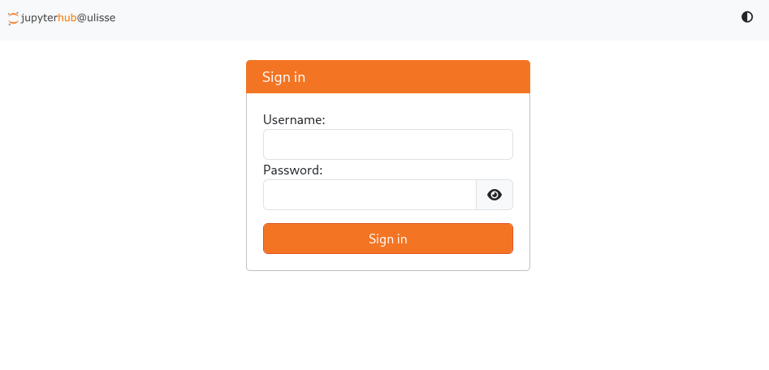
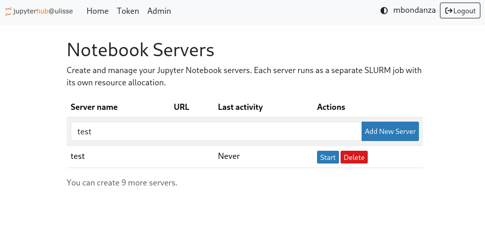

[Jupyterhub](https://jupyterhub.chpc.sns.it) is an easy and powerful interface to Ulisse's 
computational resources. It allows to run Jupyter Notebook with `Python` and `R` kernels, 
to create, edit and move files from a web interface and to have a remote terminal on the 
node, again from web ui. 

## Software Requirements
To use Jupyterhub you only need a modern browser, that you likely already have installed on
your PC.

## Accounting
JupyterHub acts just as an interface and resources are always requested and allocated through
the SLURM scheduler. Please refer to [scheduler documentation](/docs/ulisse/scheduler) for more details.

## Access and Requesting a Job


Jupyterhub website is only visible from SNS internal network. 
If you are working off-site, you need to establish a VPN connection to the SNS network.
[Here](https://ict.sns.it/en/service/access/vpn) you find instructions
on how to download and configure the VPN client.



{}

### Browse [Jupyterhub webpage](https://jupyterhub.chpc.sns.it)

### Enter your personal account's username and password (the same used to ssh into Ulisse)


### Use "Add New Server" to create a new JupyterHub server instance


### Click on "Start" 


### Configure the partition, and resources needed and again on "Start" to subimit the job


### Wait for the job to start 


It can take a while, as the job have to be scheduled and the resources have to became available.
Read more about that [here](/docs/ulisse/scheduler/#power-saving).




{}

## Creating Custom Environments (Python)

The basic kernel available on JupyterHub can cover only a limited set of applications. For
more complex scientific tasks, customized environment are often needed.

Here is explained how to create a Python virtual environment to be used with JupyterHub:

{}

### Create the environment

Open a terminal in JupyterLab (or log in via SSH) and run:

```bash
python3 -m venv ~/envs/myenv
source ~/envs/myenv/bin/activate
pip install ipykernel
```

### Register it as a kernel

```bash
python -m ipykernel install --user --name myenv --display-name "Python (myenv)"
```

### Use it

Refresh JupyterLab. **Python (myenv)** now appears in the kernel picker. Install any further packages with `pip` while the environment is activated.

{}

### Checking your kernels

```bash
jupyter kernelspec list
```

To remove a kernel, run `jupyter kernelspec uninstall myenv` and delete the environment directory.

### Saving an environment

To record the packages installed in an environment, activate it and export the list to a `requirements.txt` file:

```bash
source ~/envs/myenv/bin/activate
pip freeze > ~/envs/myenv-requirements.txt
```

Store the file in your home (or another persistent location), not inside the environment directory, so it survives if the environment is deleted.

To rebuild the environment later, or on another node:

```bash
python3 -m venv ~/envs/myenv
source ~/envs/myenv/bin/activate
pip install -r ~/envs/myenv-requirements.txt
python -m ipykernel install --user --name myenv --display-name "Python (myenv)"
```


`pip freeze` lists every installed package with its exact version, including `ipykernel`. Rebuild with the same Python version you used originally, since some pinned versions are not available for every Python release.


### Removing an environment

Removing an environment takes two steps: unregister the kernel, then delete the environment directory.

```bash
# 1. Unregister the kernel (removes only the small kernel spec)
jupyter kernelspec uninstall myenv

# 2. Delete the environment itself
rm -rf ~/envs/myenv
```

Before deleting:

- Run `deactivate` if the environment is active in your terminal.
- Shut down any notebooks using it (in JupyterLab: *Kernel → Shut Down All Kernels*), otherwise they are left with a dead kernel.
- Save the package list as described above if you may want to rebuild it later.

### Installing the environment outside your home

Large environments (many small files, such as ML stacks) can be faster on the node's local disk. Create the environment under `/scratch` and register it the same way:

```bash
mkdir -p /scratch/$USER/envs
python3 -m venv /scratch/$USER/envs/myenv
/scratch/$USER/envs/myenv/bin/pip install ipykernel
/scratch/$USER/envs/myenv/bin/python -m ipykernel install --user \
    --name myenv --display-name "Python (myenv)"
```


`/scratch` is **local to each compute node**. The kernel only works when your Jupyter session runs on the node where you created the environment, and on any other node it will fail to start. Scratch may also be cleaned after a reboot or reimage, so keep a `requirements.txt` (`pip freeze > requirements.txt`) to rebuild it.



If you need the environment on every node, keep it in your home or on the shared project storage instead.
